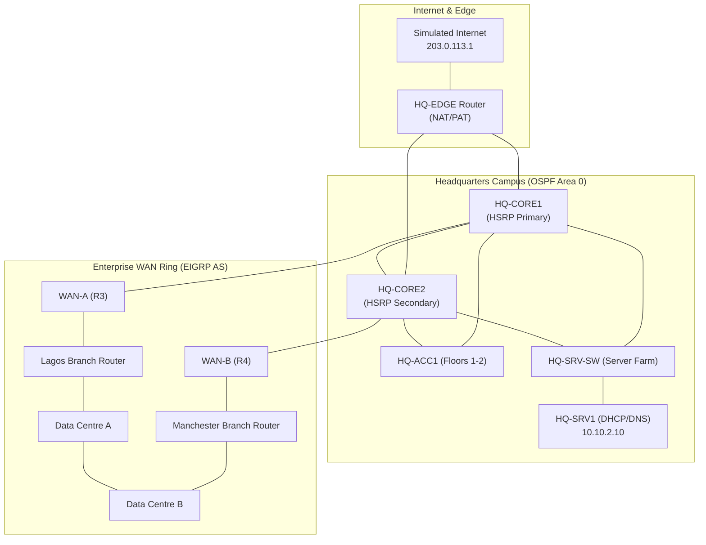

# TechPeak Enterprise: The Monday Morning Outage
### Enterprise Incident Response & Network Troubleshooting Portfolio Case Study

[-orange.svg)]()

---

## Executive Incident Brief

It is 07:40 on Monday. TechPeak, a London enterprise with a dual-core head office, two data centres, and regional branch offices across London, Lagos, and Manchester, has just exited a weekend change window. The change manager signed off the release as "successful."

By 07:55, the IT Service Desk is inundated with **16 critical incident tickets**:
- Multiple user subnets isolated from their default gateways.
- Core server farms unreachable, causing secondary DHCP failure across campus.
- The Lagos branch disconnected from the WAN ring.
- Routing anomalies between OSPF Area 0 and the EIGRP WAN backbone.
- Data centre uplink redundancy failures and edge NAT dropouts.

As the On-Call Network Engineer, this repository documents the systematic triage, proof of root cause, minimal non-disruptive remediation, and post-change verification across all 16 incidents.

---

## High-Level Network Topology

---

## Incident Resolution Matrix

Track detailed technical logs, diagnostic commands, and IOS changes in **[WORKBOOK.md](./WORKBOOK.md)**.

| Ticket | Description | Severity | Affected Device | Root Cause | Status |
|:---:|---|:---:|---|---|:---:|
| **01** | PC1 cannot reach VLAN 10 gateway | Medium | `HQ-SRV-SW` | Cascading failure from Ticket 3 (DHCP relay dropped by trunk pruning) | **RESOLVED** |
| **02** | VLAN 20 users on floor 4 (PC6) have no connectivity | High | TBD | Pending Triage | OPEN |
| **03** | HQ servers (`10.10.2.x`) unreachable from users | Critical | `HQ-SRV-SW` | Uplink trunks `Gig0/1-2` pruned VLAN 30 (`allowed vlan 40` only) | **RESOLVED** |
| **04** | PC4 is dead | Medium | TBD | Pending Triage | OPEN |
| **05** | Finance (PC5) cannot reach its gateway | High | TBD | Pending Triage | OPEN |
| **06** | WAN-B (R4) lost its link to HQ-CORE2 | High | TBD | Pending Triage | OPEN |
| **07** | Lagos office is isolated from the rest of the WAN | Critical | TBD | Pending Triage | OPEN |
| **08** | HQ cannot reach any branch networks (routers up) | Critical | TBD | Pending Triage | OPEN |
| **09** | Branch offices cannot reach the internet (HQ can) | High | TBD | Pending Triage | OPEN |
| **10** | DC-B servers are unreachable from Lagos | High | TBD | Pending Triage | OPEN |
| **11** | Manchester users cannot reach their gateway | High | TBD | Pending Triage | OPEN |
| **12** | HQ-ACC1 switch cannot be managed from another subnet | Medium | TBD | Pending Triage | OPEN |
| **13** | Console messages on HQ-CORE2 mention HSRP | Medium | TBD | Pending Triage | OPEN |
| **14** | DCA-SRV1 cannot be reached from other sites | High | TBD | Pending Triage | OPEN |
| **15** | DCA-SW2 has lost uplink redundancy | High | TBD | Pending Triage | OPEN |
| **16** | PC3 cannot reach its gateway | High | TBD | Pending Triage | OPEN |

---

## Lab Artifacts & Structure

- **`WORKBOOK.md`**: Complete incident triage workbook containing:
  - Symptoms and business impact
  - Diagnostic `show` commands proving root cause prior to configuration changes
  - Exact Cisco IOS remediation commands applied
  - Post-change verification logs
- **`TechPeak-Troubleshooting-Student.pkt`**: The Cisco Packet Tracer 9.0.1 lab file.
- **Login Credentials**:
  - Console / Enable Password: `Lab#2026`
  - Domain: `techpeak.lab`

---

## Engineering Standards & Methodology
1. **Evidence-Based Diagnostics**: Every fault is proven via CLI outputs prior to any configuration modification.
2. **Strict Root Cause Remediation**: No masking of faults with temporary static routes or ACL bypasses.
3. **Least Privilege / Minimal Change**: Only the incorrect statements are altered on target network devices.
4. **Configuration Persistence**: `write memory` executed upon verification of each remediation.
